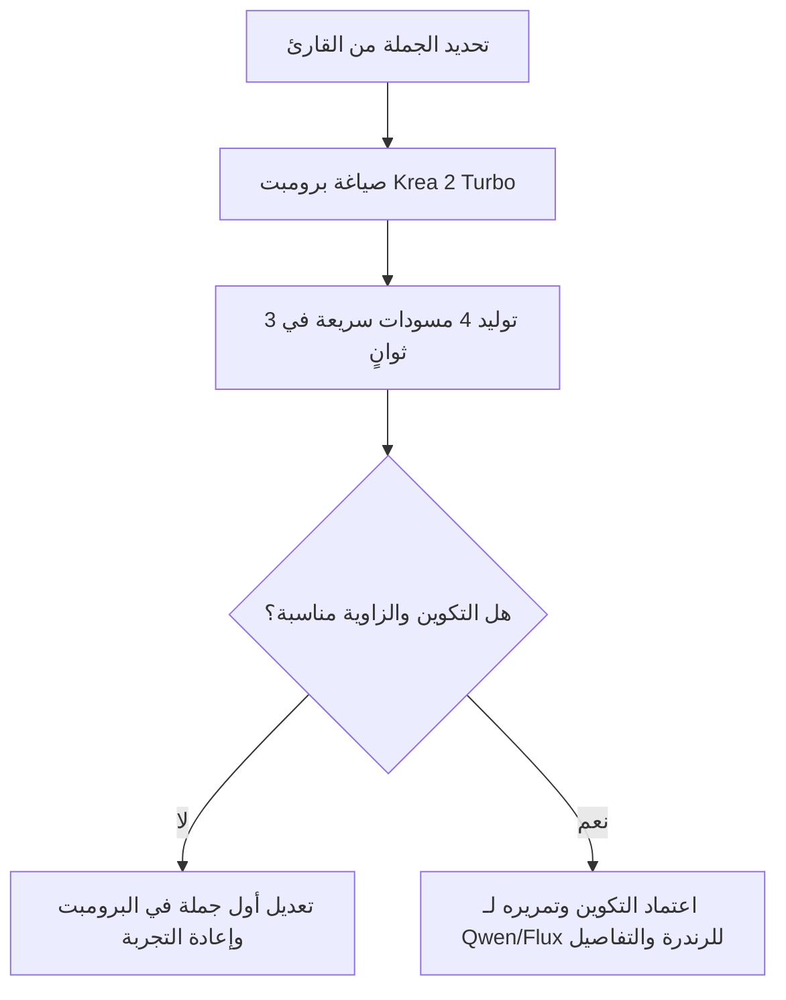

# دليل هندسة البرومبت: Krea 2 Turbo
**Model:** Krea 2 Turbo (12B+ Architecture)  
**Provider:** Krea AI  
**Use Case in Studio:** التوليد فائق السرعة، استكشاف الأنماط الفنية، بناء لوحات المزاج (Moodboards)، والتجربة السريعة للكادرات قبل الرندرة النهائية.

---

## 1. الفلسفة المعمارية للموديل (Architecture Overview)

يعتمد **Krea 2 Turbo** على معمارية بصرية ضخمة تفوق 12 مليار بارامتر (12B+) مع جدولة تقطير سريعة (Distilled Sampling Schedule). يتميز بالخصائص الآتية:
- **سرعة فائقة (2 إلى 4 ثوانٍ):** صُمم ليكون محرك المسودات والتجربة اللحظية (Drafting Engine).
- **مشفر نصي بصري (Vision-Language Text Encoder):** يفهم القواعد اللغوية الطبيعية والعلاقات المكانية والسياقية بدلاً من الكلمات المفتاحية العشوائية القديمة.
- **مرونة فنية واسعة:** لا يفرض "طابعاً واحداً" على الصور، بل يتبع بدقة تفاصيل الخامة، وسيط الرسم، ونوع الكاميرا.

---

## 2. القواعد الذهبية لكتابة البرومبت (Core Prompting Rules)

### ❌ القاعدة 1: التوقف عن حشو الكلمات الرنانة (No Keyword Confetti)
الموديل يتجاهل تماماً ولا يستفيد من الكلمات الموروثة من عصر Stable Diffusion 1.5 مثل:
- `masterpiece, 8k, photorealistic, trending on artstation, ultra detailed, hyper realistic`
> **البديل:** استبدالها بمواصفات حقيقية ملموسة (نوع العدسة، نوع الإضاءة، نسيج القماش، خامة الجلد).

### ⏳ القاعدة 2: قاعدة أسبقية الكلمات وميزانية الانتباه (The Word Budget Rule)
المشفر اللغوي يمنح وزناً بصرياً أعلى لما يظهر أولاً في الجملة:
- **إذا أردت لقطة تأسيسية واسعة (Wide Landscape):** ابدأ بوصف البيئة والطقس والإضاءة أولاً، ثم اذكر الشخصية.
- **إذا أردت لقطة بورتريه مقربة (Close-Up Portrait):** ابدأ بتفاصيل الوجه وتعبيرات العينين أولاً، ثم اذكر الخلفية ثانياً.

### ✍️ القاعدة 3: علامات التنصيص للنصوص الصريحة (Exact Typography)
عند الرغبة في ظهور نص أو لافتة أو عنوان داخل الصورة:
- ضع الكلمة المطلوبة بدقة بين علامتي تنصيص `"..."`.
- *مثال:* `A rusted metal roadside sign that reads "GAS & FOOD" with bullet holes...`

### 🎨 القاعدة 4: التحديد الفيزيائي للخامات ووسيط الفن (Medium & Textures)
اذكر الخامة بدقة هندسية:
- **في الكوميكس والرسم:** `American graphic novel comic art, heavy ink line-work, bold crosshatching, muted matte color palette`.
- **في الواقعية الفوتوغرافية:** `35mm film photograph, Kodak Portra 400 grain, soft diffuse overcast daylight, shallow depth of field`.
- **في الثري دي والألعاب:** `Matte vinyl designer toy, smooth polymer texture, subsurface scattering, ambient studio rim light`.

---

## 3. هيكل البرومبت القياسي (The Universal Prompt Formula)

```text
[Camera Shot / Frame Type] + [Core Subject & Pose] + [Clothing & Textures] + [Environment & Weather] + [Lighting & Color Palette] + [Artistic Medium / Camera Specs]
```

### تفكيك العناصر:
1. **زاوية الكادر (Shot Type):** `Extreme wide establishing shot` / `Over-the-shoulder medium shot` / `Tight dramatic close-up`.
2. **الشخصية والحركة (Subject & Pose):** من موجود وماذا يفعل بفيزيائية دقيقة.
3. **الملابس والعتاد (Clothing & Gear):** نوع الأقمشة، الألوان، درجات الاتساخ أو التمزق.
4. **المكان والطقس (Environment & Atmospheric Mood):** عناصر الخلفية، الثلج، الضباب، المطر.
5. **الإضاءة (Lighting):** مصدر الضوء، اتجاهه، والظلال (مثل: `warm tungsten rim light`, `harsh freezing overcast`).
6. **الوسيط البصري (Style/Medium):** كوميكس، فيلم سينمائي، زيت، ديجيتال.

---

## 4. أمثلة عملية جاهزة للاستخدام في مشروع الاستوديو (A Warm Place)

### مثال 1: كادر سينمائي للبرية الجليدية والبطل (Establishing Shot)
```text
Wide cinematic establishing shot of a lone rugged male survivor trekking through a vast frozen post-apocalyptic wasteland. He wears a heavy-duty distressed charcoal winter coat, torn thermal pants, and scuffed black snow boots, carrying a weathered canvas backpack. Barren skeletal trees in the far distance, cold grey overcast sky with drifting snowfall, harsh freezing wind mist, muted desaturated color palette with pale blue and icy white tones, 35mm cinematic film still.
```

### مثال 2: لقطة كوميكس درامية مقربة لكدمات البطل (Comic Close-Up)
```text
Dramatic close-up comic book panel of a rugged man in his late 20s. A noticeable dark purple black eye on his left cheek, split lower lip with dry blood, determined exhausted expression. Frost forming on his stubble, breath rising in thick white steam. Graphic novel comic art style, bold inked line-art, gritty crosshatching shadows, high contrast dramatic side lighting, muted pulp colors.
```

### مثال 3: ظهور ماري والش داخل محطة الوقود (Medium Shot)
```text
Medium shot of a pale young woman stepping out of a dark weathered doorway inside an abandoned snowbound gas station. She has shoulder-length disheveled brown hair, anxious green eyes, wearing an oversized heavy brown winter jacket over a knitted sweater and faded blue jeans. Dusty ambient daylight filtering through cracked frosty windows, soft shadows, cinematic storytelling lighting, rich tactile textures.
```

---

## 5. الاستخدام الأمثل لميزة Style Reference (الصور المرجعية)

يدعم Krea 2 Turbo رفع حتى **4 صور مرجعية (Style References)**:
- **تثبيت البليت الفني:** ارفع صفحة من الكوميكس المفضل لديك، وسيقوم الموديل باستعارة توازن الألوان والحبر.
- **تثبيت هوية المكان:** ارفع صورة لمحطة الوقود لتوليد زوايا متعددة بنفس الطابع المعماري.
- **مقياس القوة (Reference Strength):** اضبط القوة على `60% - 75%` للسماح للموديل بتنفيذ الأوامر الجديدة دون التصلب على الصورة الأصلية.

---

## 6. سير العمل المقترح داخل الاستوديو (Turbo -> Polish)


