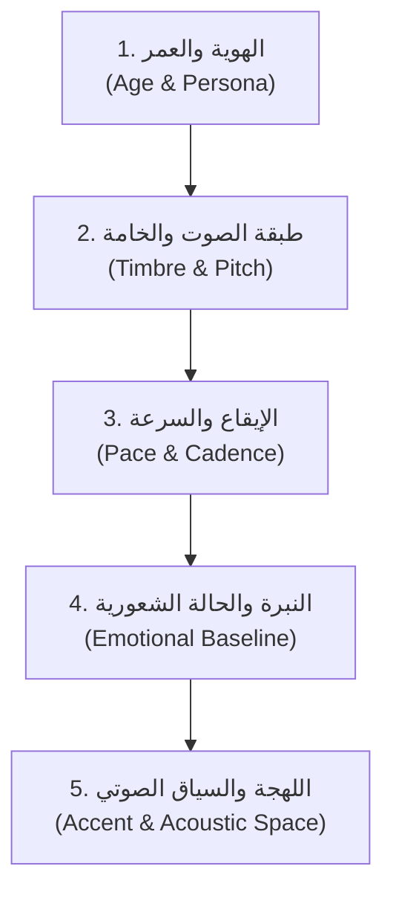

# دليل هندسة البرومبت: Qwen Voice Design (Qwen3-TTS / CosyVoice)
**Model:** Qwen3-TTS Voice Design (1.7B / 0.6B) & CosyVoice  
**Provider:** Alibaba Cloud / Qwen Audio & FunAudioLLM  
**Primary Roles in Studio:** ابتكار بصمات صوتية فريدة للشخصيات (Zero-Shot Voice Design) عبر الوصف النصي المجرد دون الحاجة لتسجيلات صوتية مسبقة، توليد أداء الراوي (Voice-Over)، والدبلجة الصوتية للحوارات (Spoken Dialogue TTS).

---

## 1. ما هي تقنية Voice Design؟ (How it Works)

تختلف تقنية **Voice Design** في معمارية Qwen عن أنظمة تحويل النص إلى كلام (TTS) التقليدية:
- **في الأنظمة التقليدية:** تختار من أصوات مسبقة محفوظة (Presets) أو ترفع ملف صوتي مسجل (Voice Clone).
- **في Qwen Voice Design:** **أنت تصمم الصوت من الصفر بكتابة مواصفاته الصوتية والتشريحية باللغة الطبيعية**! الموديل يترجم كلماتك (مثل: رخيم، جاف، خشن، هادئ) إلى شفرات صوتية صوتية (Multi-Codebook Speech Tokens) تنتج خامة صوت جديدة ومطابقة للشخصية بدقة متناهية.

---

## 2. الأبعاد الخمسة الإلزامية في برومبت بصمة الصوت (The 5 Dimensions)

لكتابة برومبت بصمة صوت احترافي وثابت، يجب أن يشمل الوصف 5 محاور أساسية:



1. **الهوية والعمر (Persona):** ذكر الجنس والعمر التقريبي (مثال: `a rugged male survivor in his late 20s`).
2. **الخامة والرنين (Timbre & Pitch):** نوع الصوت وتجويف الرنين:
   - للرجال: `deep resonant baritone`, `gravelly bass`, `dry rough vocal fry`.
   - للنساء: `warm mid-range contralto`, `bright breathy soprano`, `clear crystalline voice`.
3. **سرعة الإيقاع والوقفات (Pace & Cadence):** `calm measured pacing`, `deliberate pauses between sentences`, `rapid anxious delivery`.
4. **النبرة والمشاعر (Emotion & Attitude):** `wry and reflective`, `cautious and slightly trembling`, `commanding and assertive`.
5. **البيئة الصوتية واللهجة (Acoustics & Accent):** `neutral North American accent`, `dry studio close-mic warmth with no room echo`, `intimate whispering tone`.

---

## 3. المعادلة القياسية لصياغة بصمة الصوت (Prompt Formula)

```text
[Gender, Age & Persona] + [Vocal Pitch, Resonance & Texture] + [Pacing & Rhythmic Cadence] + [Emotional Tone & Psychological State] + [Accent, Microphone Proximity & Acoustic Environment]
```

---

## 4. بصمات صوتية جاهزة لأبطال رواية *A Warm Place*

### بصمة صوت 1: البطل والراوي (Chris Weston - Narrator V.O. & Dialogue)
> **الهدف:** صوت بطل هادئ، متعب من النجاة، رخيم، يملك نبرة سخرية هادئة وتقبل للواقع، مريح للأذن في التعليق الصوتي المطول.

```text
A rugged male survivor in his late 20s with a deep, grounded baritone voice. His vocal texture has a dry, slightly gravelly edge with subtle warm vocal fry on the low registers. He speaks at a calm, measured pace with steady, reflective pauses, projecting an attitude of quiet resilience, cynical amusement, and unbothered acceptance. Neutral North American accent, intimate close-mic studio recording with rich low-frequency clarity, warm proximity effect, and zero background echo.
```

### بصمة صوت 2: ماري والش (Mary Walsh - Character Voice)
> **الهدف:** صوت فتاة شابة متوسطة الطبقة، مشوب بالبرد والقلق في البداية، يتحول إلى نبرة تسلطية ومحسوبة وماكرة أثناء عرض الصفقة.

```text
A young adult female in her early 20s with a clear, expressive mid-range voice. Her vocal timbre is slightly breathy with a delicate, tight quality that shifts smoothly from nervous vulnerability to a sharp, coy, and calculating delivery. She speaks with moderate pacing, pausing hesitantly on key words before delivering punchy, direct demands with a subtle smirk in her breath. Clear American accent, crisp close-mic recording, clean natural resonance without reverb.
```

---

## 5. كيفية توجيه الأداء لكل جملة (Performance Modifiers)

بعد تحديد بصمة الصوت الأساسية (Voice Print)، يمكنك توجيه الجملة الحوارية المحددة بإضافة توجيه أداء لحظي (Performance Instruction Tag):

### أ) عند نطق حوار متوتر أو هامس:
```text
[Instruction: Whisper with a tense, shivering breath, looking around nervously]
"I know someone’s in there... I’d rather not have a fight."
```

### ب) عند نطق حوار ساخر أو عابث:
```text
[Instruction: Chuckle softly mid-sentence, relaxed amused tone]
"Mistress, huh? Show me your tits."
```

### ج) عند نطق التعليق الصوتي الاسترجاعي (V.O.):
```text
[Instruction: Cinematic deep voice-over, slow reflective cadence, slight pause after the first line]
"I was oddly suited for the end of the world. Or, I should say, I was oddly suited for this end of the world."
```

---

## 6. القواعد الذهبية لثبات الصوت عبر المشاهد (Voice Consistency Rules)

1. **ثبات نص بصمة الصوت (Keep Prompt Identical):**
   لحفظ نفس الصوت عبر كل فصول الرواية، قم بتخزين برومبت بصمة الصوت لكريس في حقل `voice_design_prompt` في ملف `asset_bible.json` واستخدمه كـ `System Voice Prompt` في كل طلب توليد.
2. **تجنب الصفات المتناقضة:**
   لا تدمج صفات متضادة مثل (`shrill high-pitched deep bass`) لأنها تربك مصفوفات التوكنز في الموديل وتنتج تذبذباً غير طبيعي.
3. **توليد بصمة صوت مرجعية (Audio Seed / Reference):**
   بمجرد أن يُعجبك مقطع صوتي ناتج من Voice Design، احفظ أول 5 ثوانٍ منه كملف `chris_voice_anchor.wav`. يمكنك استخدام هذا الملف لاحقاً كمرجع Zero-Shot Cloning إذا أردت تثبيتاً فيزيائياً مطلقاً.
