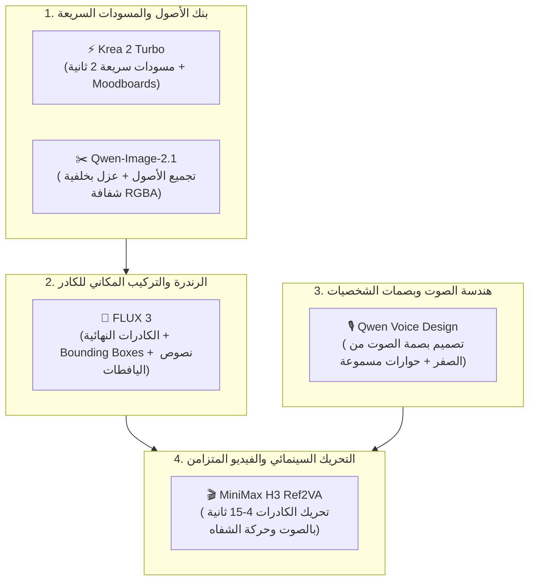

# دليل استوديو الإنتاج المتكامل: خط أنابيب الموديلات الخمسة
**المشروع:** تحويل الروايات إلى كوميكس وفيديو بالذكاء الاصطناعي بالكامل (AI Comics & Movies Studio)  
**فلسفة النظام:** تجربة تفاعلية ممتعة وسهلة كاللعبة (Game Studio Workflow)

---

## 🗺️ خريطة توزيع الأدوار بين الموديلات الخمسة (The 5-Model Ecosystem)

---

## 🎮 حلقة اللعب في الاستوديو (The Game Loop)

| المرحلة (Level) | اسم المرحلة | الموديل المستخدم | ما يحدث فيها ببساطة |
| :---: | :--- | :--- | :--- |
| **المستوى 1** | **خزانة الأبطال والأصول (Inventory & Assets)** | `Qwen-Image-2.1` & `Krea 2 Turbo` | استخراج مواصفات البطل والملابس والعتاد من الرواية، وتوليد كروت أصلية مفرغة بخلفية شفافة (RGBA) لتثبيت شكل الشخصية. |
| **المستوى 2** | **لوحة كادرات الكوميكس (Comic Panel Layout)** | `FLUX 3` & `Qwen-Image-2.1` | توزيع الشخصيات والأماكن على كادر المشهد باستخدام نظام الإحداثيات المكانية `[ymin, xmin, ymax, xmax]` دون أي تداخل عشوائي. |
| **المستوى 3** | **بصمة الصوت والأداء (Voice Print Studio)** | `Qwen Voice Design` | ابتكار بصمة صوتية ثابتة للبطل وماري والراوي عبر الوصف الطبيعي، وتسجيل أسطر الحوار بدقة. |
| **المستوى 4** | **غرفة الإخراج والتحريك (The Movie Forge)** | `MiniMax H3 Ref2VA` | تغذية كادر الكوميكس المعتمد (`<Picture 1>`) مع الصوت المسجل (`<Audio 1>`) لتحريك المشهد كفيديو سينمائي متزامن كلياً. |

---

## 📚 روابط الأدلة التفصيلية الرسمية لكل موديل:

1. [دليل Krea 2 Turbo: التوليد فائق السرعة واستكشاف الأنماط](./01_krea_2_turbo.md)
   - التخلص من حشو الكلمات المفتاحية (`No Keyword Confetti`).
   - قاعدة ميزانية الانتباه وترتيب الكلمات (`The Word Budget`).
   - استعارة الأنماط عبر مراجع الستايل (Style References).

2. [دليل Qwen-Image-2.1: التجميع المتعدد والشفافية الأصلية](./02_qwen_image_2_1.md)
   - دمج حتى 10 صور مرجعية في كادر واحد (Multi-Reference Assembly).
   - توليد كروت أصول مفرغة بقناة ألفا حقيقية (Native Transparent RGBA).
   - التعديل الموجه بالأوامر والتعليمات (Instruction Editing).

3. [دليل FLUX 3: الرندرة النهائية والتحكم المكاني الصارم](./03_flux_3.md)
   - الإلغاء التام للبرومبت السلبي (No Negative Prompts).
   - نظام المربعات المكانية والإحداثيات `[ymin, xmin, ymax, xmax]`.
   - كتابة النصوص واليافطات واللوحات الصريحة داخل الكادر.

4. [دليل Qwen Voice Design: تصميم بصمات الصوت الطبيعية](./04_qwen_voice_design.md)
   - ابتكار أصوات الشخصيات من الصفر بدون عينة صوتية سابقة (Zero-Shot).
   - المحاور الخمسة لهندسة الصوت (العمر، الرنين، الإيقاع، المشاعر، البيئة الصوتية).
   - نماذج جاهزة لصوت كريس (الراوي) وماري والش.

5. [دليل MiniMax H3 Ref2VA: الفيديو السينمائي متزامن الصوت](./05_minimax_h3_ref2v.md)
   - الهيكلية الرسمية للأقسام الستة الإلزامية (`subject_definitions`, `summary`, `retention_analysis`, `detailed_description`, `overall_soundscape`, `non_diegetic_music`).
   - تزامن حركة الشفاه بالوسم `<d>` والصوت المرجعي `<Audio N>`.
   - برومبت عملي كامل جاهز للتنفيذ الفوري لمشهد خروج ماري والش وتفاوضها مع كريس.
